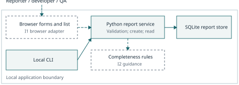

# Structured Bug Report Helper

Collaborative methods, project plan and workflow trial

AUT Contemporary Methods in Software Engineering — Assignment 1

**Working draft: names supplied; IDs/accounts blank by request. Equal shares are planned, not verified contributions. Independent review and assessor access remain pending.**

| Member | Name | Student ID | GitHub |
| --- | --- | --- | --- |
| A | Fengyi Zhan |  |  |
| B | Kaile Shao |  |  |
| C | jianqiao Fang |  |  |
| D | xin Li |  |  |

Conservative main-text count: 1325 (limit 1,500).

## 1. Project definition and boundaries

Vague defect reports force developers to request clarification before debugging. This lecturer-approved project helps small student software teams supply consistent information. Bettenburg et al. (2008) identified a mismatch between developers' information needs and reporters' submissions; Soltani et al. (2020) provide further evidence for the value of reproduction information. These studies motivate the design; benefits for our team remain unmeasured.

Reporters need clear prompts; developers need reproducible descriptions; team leaders need visible progress; testers need expected and actual outcomes; the instructor needs credible process evidence. Iteration 1 covers creation, viewing and status updates for reports containing title, description, reproduction steps, expected behaviour, actual behaviour, environment and severity. Iteration 2 adds completeness scoring, missing-information guidance and filtering. AI diagnosis, automatic fixes, external tracker integration, mobile apps and advanced analytics are excluded.

Constraints are four members, limited availability, two short iterations and a local single-instance prototype using synthetic data. Requirements may change after feedback; shared storage changes can conflict; incomplete or misleading descriptions threaten quality. The plan therefore combines reprioritisation, controlled integration and acceptance evidence. The shared development repository does not imply a remotely shared application database. No existing application code is imported; Python's standard library supplies storage and tests.

## 2. Comparison and justified selection

Compare lifecycle organisation separately from collaboration practices: iterative-incremental development can support either planned or agile working (Larman & Basili, 2003). Table 1 assesses alternatives against this project's uncertainty, coordination cost and quality needs.

Table 1. Development options in the project context

| Option | Merits | Cost and contextual fit |
| --- | --- | --- |
| Plan-driven baseline | Up-front field definitions, responsibilities and verification plans improve predictability and traceability. | Freezing guidance before users try it risks rework. Useful for stable storage contracts; excessive detailed planning would consume scarce implementation time. |
| Iterative-incremental lifecycle | An operational reporting increment exposes usability assumptions before guidance is added; feedback informs the next increment. | Repeated integration and regression testing cost time. Iteration alone does not guarantee collaboration, review or responsiveness. |
| Agile practices within increments | Prioritised stories, frequent feedback, short branches and retrospectives make uncertainty and blockers visible. | Needs available stakeholders and disciplined decisions. Uncontrolled reprioritisation or ceremonial meetings could undermine the fixed scope. |

We select two timeboxed increments with lightweight agile practices and explicit acceptance criteria. This preserves a feasible baseline while allowing feedback to change guidance rather than reopening every requirement. Boehm and Turner (2003) support balancing practices according to risk. Dybå and Dingsøyr's (2008) review reports limited, context-dependent evidence, largely concerning early XP adoption; it cannot establish that agile universally outperforms alternatives. Our choice follows the project's small size, low criticality and uncertain usability, rather than an assumed productivity advantage.

Code review and CI address specific integration and quality risks. McIntosh et al. (2014) associate review participation with quality in large open-source systems; this observational finding supports substantive discussion, without predicting our defect reduction. Elazhary et al. (2022) show that CI practices vary by context and can introduce feedback delays; our pipeline therefore stays small and reproducible.

For a distributed team, retain increments but add asynchronous decision records, explicit handovers and agreed review windows, drawing cautiously on Camara et al.'s (2024) large-scale review. For a regulated system, increase risk analysis, requirement-test traceability and formal approval evidence while retaining feedback cycles (Boehm & Turner, 2003). Neither context warrants choosing a method by label alone.

## 3. Iterations, design and risk

A/B/C/D map to the named members on the title page: A owns requirements and feedback, B browser interaction, C service/storage, and D testing/CI. Table 2 assigns author/reviewer pairs; estimates are person-hours. Dependencies follow the listed sequence.

Table 2. Prioritised backlog and acceptance criteria

| Item / priority | Acceptance evidence | Iteration; hours; owner/reviewer |
| --- | --- | --- |
| BR-01 / Must | Persist seven fields, unique ID, UTC time and Open status. Reject blank title or invalid severity without inserts; fresh connection reads identical content. | I1; 4; C/D |
| BR-02 / Must | Browser create/list survives reload; invalid input retains form data with accessible errors; keyboard use succeeds; report text renders safely. | I1; 6; B/C |
| BR-03 / Must | Persist Open/In progress/Resolved transitions and reopening; reject invalid status or unknown IDs without mutation. | I1; 4; C/B |
| BR-04 / Must | Score round(100n/7) for six nonblank text fields plus explicit severity: 6/7=86, 7/7=100. Identify missing fields; incomplete optional text remains savable. | I2; 5; B/D |
| BR-05 / Should | Severity/status filters combine with AND; clearing restores all reports; empty results are explicit and data unchanged. | I2; 3; C/B |
| BR-06 / Must | Clean checkout passes applicable acceptance checks; record exploratory feedback, reproduction outcomes and exact release evidence. | I1 2h, I2 4h; D+A/C |

Assume two working days and 20 available person-hours per iteration, subject to team confirmation. I1 targets usable creation/list/status with 16 planned hours and four contingency hours. I2 targets evaluated guidance/filtering with 12 planned hours and eight contingency hours. Drop BR-05 first if capacity slips. A1 setup and the BR-01 trial occur in Week 1; proven work is reused in Assignment 2. Each increment ends with demonstration, reprioritisation and one retrospective improvement.

Figure 1 separates adapters, rules and persistence. Python/SQLite reduces setup for local use; parameterised transactions protect stored text. A pure scoring function supports isolated tests. Completeness measures information presence, not truth. No authentication or public hosting is assumed.

Figure 1. System overview: solid = implemented trial; dashed = planned

Key risks have explicit triggers: if Must estimates exceed capacity, A freezes scope and removes filtering; simultaneous schema edits trigger C's paired integration; a PR waiting one working day triggers D's backup reviewer. Misleading high scores trigger B's guidance revision. D checks persistence after restart; A verifies assessor access before submission.

Evaluation targets all applicable acceptance checks passing and no critical defects. In I2, four consenting peers compare matched synthetic tasks with and without guidance, alternating order. Record completion time, information completeness and independent reproduction without clarification. Report descriptive outcomes and convenience-sample limits; no results or causal improvement are claimed yet.

## 4. Workflow trial and individual contributions

The private repository contains six tracked requirements (E1). Issue #1 preceded branch feat/1-create-report and draft PR #7 (E2). The trial implements service/CLI creation, not the planned browser increment. Implementation 0eed2879192c3b6d4feb55484dbb040dd39c6560 passed 16 local tests and remote Python 3.11/3.12 acceptance and compile checks (E3). Tests cover persistence across processes, rejected inputs without inserts, metadata and Unicode/SQL-like text.

An initial missing-module failure established the absent feature. Execution then exposed Windows cleanup errors: a test helper completed SQLite transactions without closing connections. Explicit closure corrected the failure. The practical lesson is to review resource lifetime as well as transaction correctness and test across environments; green CI alone cannot establish usability.

The intended workflow is Issue, short branch, tested PR, substantive non-author review, author response and approved merge. Limit implementation work in progress to two items. Done requires acceptance checks, latest-SHA approval and updated evidence. GitHub returned HTTP 403 for private-repository branch protection, so approval remains a manual rule. PR #7 currently has no independent review and remains unmerged. Consequently, the collaborative trial is incomplete; a teammate must review and rerun a check before finalisation. Assessor access and the final reviewed submission SHA also remain pending.

Codex prepared research, code, tests and documents through the owner's account; this cannot establish student contributions. Planned workload is 25% each: Fengyi Zhan (requirements/research/evaluation), Kaile Shao (interaction/accessibility), jianqiao Fang (service/persistence), and xin Li (acceptance/CI). Each has five planned hours per iteration. Student IDs and accounts are blank by request. Actual decisions, results and activity links remain to be verified; the meeting scripts are drafts, and peer evaluation is prepared but not run.

## References

Bettenburg, N., Just, S., Schröter, A., Weiss, C., Premraj, R., & Zimmermann, T. (2008). What makes a good bug report? In *Proceedings of the 16th ACM SIGSOFT International Symposium on Foundations of Software Engineering* (pp. 308–318). Association for Computing Machinery. https://doi.org/10.1145/1453101.1453146

Boehm, B., & Turner, R. (2003). Using risk to balance agile and plan-driven methods. *Computer, 36*(6), 57–66. https://doi.org/10.1109/MC.2003.1204376

Camara, R., Marinho, M., & Moura, H. (2024). Agile tailoring in distributed large-scale environments using agile frameworks: A systematic literature review. *CLEI Electronic Journal, 27*(1), Article 8. https://doi.org/10.19153/cleiej.27.1.8

Dybå, T., & Dingsøyr, T. (2008). Empirical studies of agile software development: A systematic review. *Information and Software Technology, 50*(9–10), 833–859. https://doi.org/10.1016/j.infsof.2008.01.006

Elazhary, O., Werner, C., Li, Z. S., Lowlind, D., Ernst, N. A., & Storey, M.-A. (2022). Uncovering the benefits and challenges of continuous integration practices. *IEEE Transactions on Software Engineering, 48*(7), 2570–2583. https://doi.org/10.1109/TSE.2021.3064953

Larman, C., & Basili, V. R. (2003). Iterative and incremental development: A brief history. *Computer, 36*(6), 47–56. https://doi.org/10.1109/MC.2003.1204375

McIntosh, S., Kamei, Y., Adams, B., & Hassan, A. E. (2014). The impact of code review coverage and code review participation on software quality: A case study of the Qt, VTK, and ITK projects. In *Proceedings of the 11th Working Conference on Mining Software Repositories* (pp. 192–201). Association for Computing Machinery. https://doi.org/10.1145/2597073.2597076

Soltani, M., Hermans, F., & Bäck, T. (2020). The significance of bug report elements. *Empirical Software Engineering, 25*(6), 5255–5294. https://doi.org/10.1007/s10664-020-09882-z

## Appendix A. Supporting evidence index

| ID | Evidence | Current status |
| --- | --- | --- |
| E1 | [Issues #1–6](https://github.com/alwaysgoodz/aut-bug-report-helper/issues), [Backlog](https://github.com/alwaysgoodz/aut-bug-report-helper/blob/feat/1-create-report/docs/backlog.md) | Prioritised requirements and acceptance criteria exist. |
| E2 | [Issue #1](https://github.com/alwaysgoodz/aut-bug-report-helper/issues/1), [Draft PR #7](https://github.com/alwaysgoodz/aut-bug-report-helper/pull/7) | Implementation exists; independent review and approved merge pending. |
| E3 | [Implementation](https://github.com/alwaysgoodz/aut-bug-report-helper/commit/0eed2879192c3b6d4feb55484dbb040dd39c6560), [CI run](https://github.com/alwaysgoodz/aut-bug-report-helper/actions/runs/41673631149) | Implementation SHA: 0eed2879192c3b6d4feb55484dbb040dd39c6560; both Python jobs passed. |
| E4 | [Trial record](https://github.com/alwaysgoodz/aut-bug-report-helper/blob/feat/1-create-report/docs/trial-record.md), [logs](https://github.com/alwaysgoodz/aut-bug-report-helper/tree/feat/1-create-report/docs/evidence) | Actual test evidence and corrective lesson; no user evaluation results. |
| E5 | [Contribution ledger](https://github.com/alwaysgoodz/aut-bug-report-helper/blob/feat/team-study-preparation/docs/contributions.md) | Names supplied; IDs/accounts blank and actual activity links unverified. |
| E6 | [Setup/test README](https://github.com/alwaysgoodz/aut-bug-report-helper/blob/feat/1-create-report/README.md), [workflow rules](https://github.com/alwaysgoodz/aut-bug-report-helper/blob/feat/1-create-report/CONTRIBUTING.md) | Reproducible feature instructions; manual review gate. |

Repository access is private. Invite the real team and assessor and verify their access. The implementation SHA is a verified review snapshot, not a final submission release. Final release identity must follow independent approval and complete contribution records.

Preparation assistance: Codex assisted with literature discovery, synthesis, report drafting, diagram, code, tests and repository setup. This acknowledgement describes actual assistance; the team must adapt it to the course's rules and verify all submitted material. No independent team review or user study is claimed by these generated materials.

